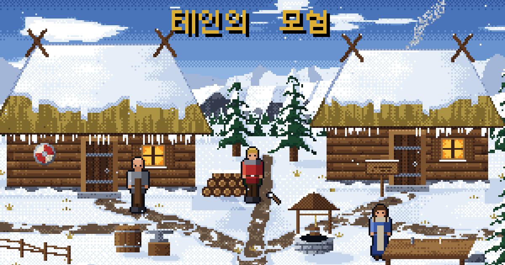
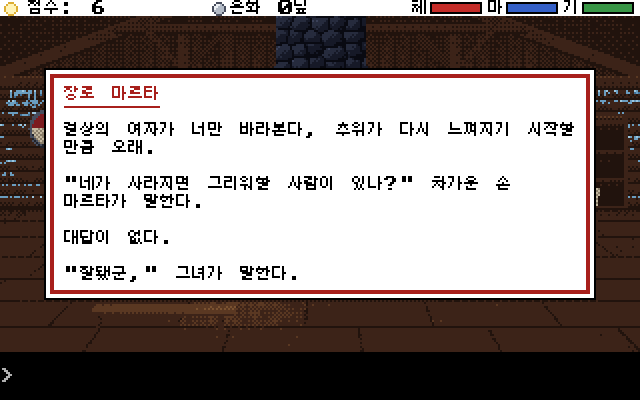

# 테인의 모험 (Thane's Quest 한국어판)



얼어붙은 골짜기를 배경으로 한 오픈월드 액션 RPG입니다. 초기 타이핑 어드벤처의 껍데기 안에
실시간 전투를 얹었고, 모든 것을 클릭·탭·숫자 키로 할 수 있습니다. 직접 입력하면 그 이상도
됩니다.

**이 저장소는 한국어판입니다.** 방 묘사·대사·메뉴·안내 문구까지 전부 한국어로 옮겼고,
명령도 한국어로 입력할 수 있습니다(영문 명령도 그대로 동작합니다).

## 지금 플레이

https://sigco3111.github.io/thanes-quest-ko/

저장은 브라우저에, 주소별로 보관됩니다.

## 스크린샷

| | |
|---|---|
|  |  |
|  |  |

## 명령 입력 예시

한국어와 영어를 섞어 써도 됩니다.

- `봐` / `look` — 둘러보기
- `표지판 읽어` / `read sign`
- `도끼 가져가` / `take hatchet`
- `도끼 장비` / `equip hatchet`
- `마르타와 이야기` / `talk to marta`
- `장로에게 고분 물어봐` / `ask elder about the barrow`
- `가방` / `bag`, `일지` / `journal`, `저장하기`·`불러오기`(메뉴)

## 직접 돌리기

```bash
npm install
npm run dev
```

Vite가 출력하는 주소(보통 http://localhost:5173/)를 열면 됩니다.

| 명령 | 설명 |
|---|---|
| `npm run dev` | 개발 서버(디버그 명령 활성) |
| `npm test` | 단위 테스트 + 게임 전체를 헤드리스로 끝까지 플레이하는 워크스루 테스트 |
| `npm run typecheck` | 타입 검사만 |
| `npm run build` | 배포용 빌드 |

## 번역에 대해

- 모든 사용자 노출 문자열(방 묘사, 대사, 표지판, 메뉴, 도움말, 시스템 메시지)을 한국어로
  옮겼고, 테스트의 기대 문구도 실제 한국어 출력 기준으로 맞췄습니다. 테스트 279개 전부 통과.
- 한국어 글꼴은 **Galmuri7**(이민서, SIL Open Font License 1.1)을 8x8 비트맵으로 변환해
  사용합니다. 원본: https://github.com/quiple/galmuri — 라이선스 전문은
  [assets/fonts/Galmuri7-OFL.md](assets/fonts/Galmuri7-OFL.md)에 함께 넣었습니다.
- 룬 문자(VETH, ISKA, ORUN, SOL)는 원작처럼 라틴 문자 그대로 입력합니다.

## 원작과 라이선스

원작은 rdhelms의 **Thane's Quest**(https://github.com/rdhelms/thanes-quest)입니다.
세계·이름·등장인물·그림·소리·문장 전부 원작자의 오리지널이며, MIT 라이선스로
무엇에든 자유롭게 쓰고 고치고 나눌 수 있습니다([LICENSE](LICENSE) 참조). 한국어 번역도
같은 조건으로 둡니다.
