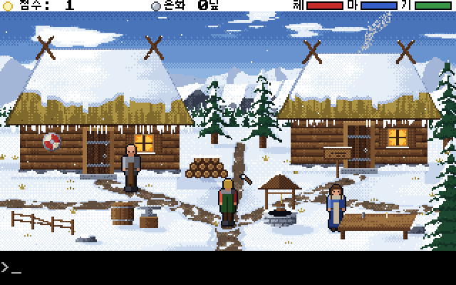
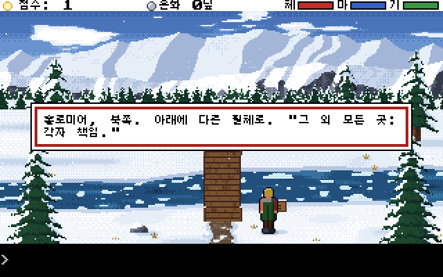
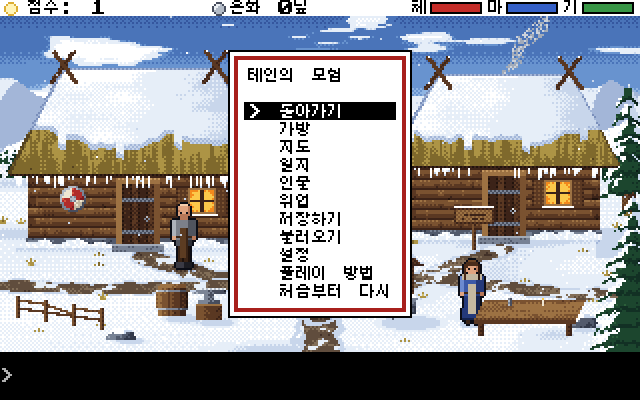
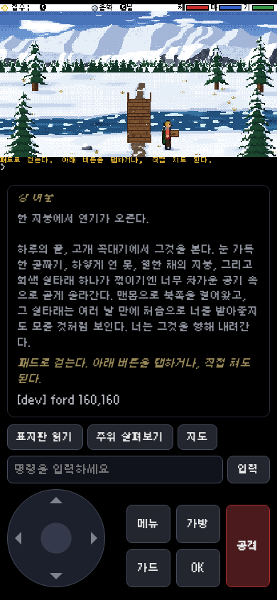

# 테인의 모험 (Thane's Quest) — 한국어판



눈 덮인 북쪽 땅, 맨몸으로 걸어온 한 사람이 홀로미어 마을에 닿는다. 텍스트 명령으로 노는 픽셀아트 오픈월드 어드벤처 **Thane's Quest**의 한국어판입니다. 설치 없이 브라우저에서 바로 플레이할 수 있습니다.

**지금 플레이: https://sigco3111.github.io/thanes-quest-ko/**

## 주요 특징

- 지문·대화·메뉴·도움말·HUD까지 게임 내 사용자 노출 문자열 전체 한국어화
- 한국어 명령 입력("표지판 읽어", "도끼 가져가", "대화")과 영어 명령("read sign", "take hatchet") 동시 지원
- 모바일 터치 화면: 방향 패드, 상황별 명령 버튼("통나무를 화로에 놓기" 등), 한글 웹폰트(Galmuri7) 적용
- 저장/불러오기, 지도, 일지, 인물, 위업 등 원작 시스템 그대로

## 스크린샷

| 표지판 읽기 | 메뉴 |
| --- | --- |
|  |  |

| NPC 대화 | 모바일 명령 버튼 |
| --- | --- |
|  |  |

## 설치 및 실행

GitHub Pages 배포본은 위 링크에서 바로 플레이할 수 있습니다. 로컬에서 실행하려면:

```bash
npm install
npm run dev      # 개발 서버
npm run build    # 프로덕션 빌드 (dist/)
npm test         # 테스트 (279개)
```

## 기술 메모

- 원작의 수작업 픽셀 폰트 렌더링을 그대로 두고, 한글 음절은 Galmuri7에서 래스터화해 캔버스에 그립니다 (src/engine/kofont.ts).
- DOM(UI 버튼, 패널, 입력창)에는 사용 글자만 담은 Galmuri7 서브셋 웹폰트(약 63KB)를 @font-face로 적용해 한글 시스템 폰트가 없는 환경에서도 깨지지 않습니다.
- 명령 파서는 한국어 동사/명사 어휘를 추가해 원래 영어 파서와 같은 규칙으로 처리하며, 영어 명령과 완전히 호환됩니다.
- 룬 문자(VETH/ISKA/ORUN/SOL)는 원작 설정 그대로 라틴 문자로 표기합니다.

## 라이선스 및 크레딧

- 원작: **Thane's Quest** by rdhelms — https://github.com/rdhelms/thanes-quest (MIT License, "Everything in it is original and free to use")
- 한글 픽셀 폰트: **Galmuri7** (c) 2019-2025 Lee Minseo — SIL Open Font License 1.1 (사본: assets/fonts/Galmuri7-OFL.md)
- 한국어화: sigco3111 — 원작과 동일하게 MIT License
